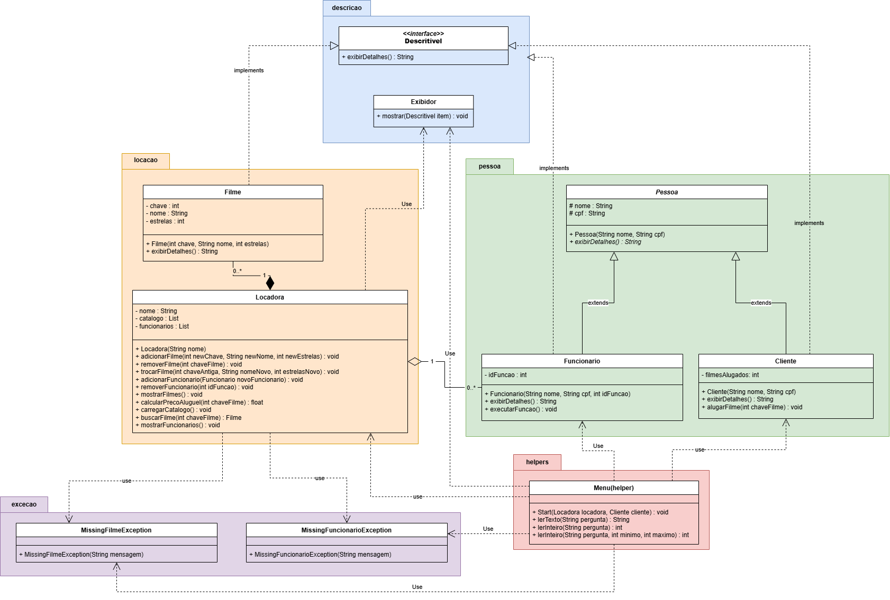

# Locadora de Filmes — Master Tape

Projeto Final (NP2) - **C06 Programação Orientada a Objetos**
Instituto Nacional de Telecomunicações (Inatel) - Prof. Christopher Lima

---

## Integrantes

- CARLOS EDUARDO CARVALHO VILAS BOAS - 441
- LAÍS CARLOS RODRIGUES - 681
- PEDRO GASPAROTTO CARVALHO - 655
- VICTOR DOS ANJOS MENDONÇA - 

---

## Sobre o projeto

Sistema de console que simula a operação de uma locadora de filmes, com dois perfis
de acesso: **cliente** e **funcionário**.

- O cliente consulta o catálogo, monta um carrinho, finaliza a compra e consulta os
  próprios dados.
- O funcionário administra o catálogo (cadastrar, remover, substituir filmes) e o
  quadro de funcionários (cadastrar, remover, listar).

O catálogo é persistido em arquivo texto, de modo que os filmes cadastrados em uma
execução continuam disponíveis na execução seguinte.

**Linguagem:** Java (sem bibliotecas externas)

---

## Importante

O programa lê e grava o arquivo `catalogo.txt` por **caminho relativo ao diretório de
execução**. Por isso ele precisa ser executado a partir da **raiz do repositório**, e
não de dentro da pasta `Trabalho final`, caso contrário o catálogo inicia vazio e um
novo arquivo é criado no lugar errado.

---

## Estrutura de pacotes

```
Trabalho final/
├── Main.java                  (pacote default - ponto de entrada)
├── Helpers/
│   └── Menu.java              interface de console e leitura validada de entrada
├── pessoa/
│   ├── Pessoa.java            classe ABSTRATA - base da hierarquia
│   ├── Cliente.java           extends Pessoa
│   └── Funcionario.java       extends Pessoa
├── locacao/
│   ├── Locadora.java          regra de negócio e persistência em arquivo
│   └── Filme.java             item do catálogo
├── descricao/
│   ├── Descritivel.java       INTERFACE - contrato de exibição
│   └── Exibidor.java          ponto de uso do polimorfismo
└── excesao/
    ├── MissingFilmeException.java
    └── MissingFuncionarioException.java
```

---

## Diagrama UML



---

## Atendimento aos critérios de avaliação

### 01 - Boas práticas
Código dividido em cinco pacotes por responsabilidade; nomes de classes, atributos e
métodos em português e descritivos; atributos sempre privados ou protegidos, com acesso
por métodos; a leitura de entrada foi extraída para os métodos reutilizáveis
`Menu.lerTexto` e `Menu.lerInteiro`, em vez de repetir `Scanner` em cada opção do menu.

### 02 - Classes
Onze classes, cada uma com atributos, construtor e métodos próprios. Exemplos:
`Filme` (chave, nome, estrelas), `Locadora` (nome, catálogo, funcionários),
`Funcionario` (idFuncao, além do que herda de `Pessoa`).

### 03 - Herança
Duas hierarquias:

| Superclasse | Subclasses |
|---|---|
| `Pessoa` (abstrata) | `Cliente`, `Funcionario` |
| `RuntimeException` | `MissingFilmeException`, `MissingFuncionarioException` |

`Cliente` e `Funcionario` herdam `nome` e `cpf`, declarados `protected` justamente
para serem acessíveis às subclasses — e chamam o construtor da superclasse via
`super(nome, cpf)`.

### 04 - Polimorfismo
A classe `descricao.Exibidor` concentra a demonstração:

```java
public static void mostrar(Descritivel item) 
{
    System.out.println(item.exibirDetalhes());
}
```

O parâmetro é do tipo da **interface**, não de uma classe concreta. O mesmo método
atende `Filme`, `Cliente` e `Funcionario`, e a versão de `exibirDetalhes()` executada
é sempre a da classe real do objeto recebido. Pontos de chamada:
`Locadora.mostrarFilmes`, `Locadora.mostrarFuncionarios`, `Menu` (casos 3 e 5).

Há também **sobrecarga de método**: `Menu.lerInteiro(String)` e
`Menu.lerInteiro(String, int, int)` — a segunda versão valida faixa de valores.

### 05 - Interfaces e classes abstratas
Ambas presentes e com papéis distintos:

- **Classe abstrata `Pessoa`** — abstrai o **estado** comum (nome, CPF) e o construtor.
  Não pode ser instanciada, porque "pessoa" não existe isoladamente no domínio da
  locadora: existe cliente ou funcionário. Declara `exibirDetalhes()` como método
  abstrato, obrigando cada subclasse a escrever a própria versão.
- **Interface `Descritivel`** - abstrai o **comportamento** de se descrever,
  atravessando hierarquias distintas: é implementada por `Filme` (que não é `Pessoa`),
  por `Cliente` e por `Funcionario`. É o que torna possível o método único de `Exibidor`.

### 06 - Tratamento de erros
- **Exceções próprias:** `MissingFilmeException` e `MissingFuncionarioException`,
  lançadas por `Locadora.removerFilme`, `Locadora.trocarFilme` e
  `Locadora.removerFuncionario` quando a chave ou o ID não existe, e capturadas nos
  casos 3, 4 e 6 do menu do funcionário, o programa avisa o usuário e continua, em vez
  de encerrar.
- **`NumberFormatException`:** tratada em `Menu.lerInteiro` (o usuário digita letras no
  lugar de número) e em `Locadora.carregarCatalogo` (linha corrompida no arquivo é
  ignorada, sem derrubar a carga do catálogo).
- **`IOException`:** tratada em todas as operações de arquivo da `Locadora`.
- **Validações de entrada:** campo em branco é recusado em `Menu.lerTexto`; chave menor
  ou igual a zero é recusada em `Cliente.alugarFilme`; chave de filme duplicada é
  recusada em `Locadora.adicionarFilme`; ID de funcionário duplicado é recusado em
  `Locadora.adicionarFuncionario`.

### 07 - Arquivos
Persistência do catálogo em `catalogo.txt` usando a **API Java NIO**:

| Operação | Método | Onde |
|---|---|---|
| Gravar (acrescentando) | `Files.writeString` com `StandardOpenOption.CREATE, APPEND` | `adicionarFilme` |
| Ler todas as linhas | `Files.readAllLines` | `removerFilme`, `trocarFilme`, `carregarCatalogo` |
| Regravar o arquivo | `Files.write` | `removerFilme`, `trocarFilme` |
| Verificar existência | `Files.exists` | `carregarCatalogo` |

`carregarCatalogo()` é chamado na `Main` antes do menu, o que fecha o ciclo: o que foi
gravado em uma execução é lido de volta na seguinte.

### 08 - Threads
**Não utilizado.** Ausência alinhada previamente com o professor.

### 09 - UML completo
Diagrama de classes da solução disponível neste repositório (`uml.png`), com
visibilidade dos membros, herança, implementação de interface, dependências,
composição, agregação e multiplicidades.

### Relevância ao curso
Projeto da área de **Engenharia de Software**: modelagem de domínio, separação em
camadas por pacote, persistência de dados e tratamento de erros, conteúdos aplicados
diretamente no desenvolvimento de software.

---

## Declaração de uso de Inteligência Artificial

**Sim, foram utilizadas ferramentas de IA neste projeto.**

**Ferramentas:** 
- [Gemini - Laís](https://share.gemini.google/00eYaYXuHRxl)

**Como foram utilizadas:**

- **Revisão e depuração de código já escrito pelo grupo;** 
- **Esclarecimento de conceitos de POO;**
- **Revisão do diagrama UML;**
- **Preparação para a arguição;**
- **Redação deste README.**

**O que não foi feito por IA:** a concepção do sistema, a divisão em pacotes, a
modelagem das classes e a escrita do código. Cada integrante implementou a própria
parte e utilizou o material de aula além de outros meios para os estudos; a IA atuou 
como ferramenta de revisão e estudo, e cada integrante é capaz de explicar o funcionamento 
do que entregou.

